# GFAM

**Description:** a drum synthesizer for the Game Boy Advance, with a virtual patch bay, an 8-step synth sequencer, a kick with its own 16-step sequencer, parameter locks, conditional trigs, 32 patterns with a sound each, a 32-slot song, an effects chain and random pages. Two oscillators with 8 wave types. The whole app is a single 64 KB ROM. An independent, non-commercial hobby project to learn and experiment with sound synthesis on the GBA.

[Cheat sheet (PDF)](docs/GFAM-cheatsheet.pdf) &middot; [Controls](docs/CONTROLS.md) &middot; [Download the ROM](releases/) &middot; [Technical notes](docs/TECHNICAL.md) &middot; [Changelog](CHANGELOG.md) &middot; [Español](docs/README.es.md)

> [!IMPORTANT]
> **Legal notice. Please read it.**
>
> - **"GBA", "Game Boy Advance" and "Game Boy" are not my brand.** They are trademarks of Nintendo. GFAM is an independent hobby project, made to learn and experiment, with no commercial purpose. It is not made, approved, sponsored or supported by Nintendo and has no relation with them. I do not know exactly where I stand with their rights, so I claim nothing over those names, and I use them only to say which console the program is written for.
> - **This repository contains no Nintendo material**: no BIOS, no games, no SDK or library code, and **not even the Nintendo logo** that real GBA hardware looks for in the header of a ROM. The ROM in [`releases/`](releases/) is built with that field empty, and the tests fail if it is not. Everything else here was written for this project.
> - Other product names that appear in this repository belong to their owners; see [NOTICE.md](NOTICE.md).
> - I am not a lawyer and this is not legal advice: it is a plain statement of what the project contains and what I intend. If you are a rights holder and want something changed or removed, [NOTICE.md](NOTICE.md) says how to reach me.

> [!WARNING]
> **GFAM is beta software. Use it at your own risk.** It is a hobby project made by one person. It can have bugs and it is provided
> "as is", without warranty of any kind. It is a ROM for an emulator or a handheld: it does not write anything to your device,
> and **nothing is saved when you power off** (patterns and song are lost; see [what is saved](docs/CONTROLS.md#what-is-saved-and-presets)).

## What it has

- **Two VCOs** with 8 wave types (TRI, SQR, SAW, PLS, SIN, ORG, FLD, HOL), hard sync, FM 1>2, white noise and a 3-channel mixer.
- A 4-pole **LP / HP filter** with resonance, envelope and noise modulation, and three decay envelopes (VCO, VCF, VCA) with a velocity per step.
- **PATCH**: a virtual patch bay with 8 inputs (pitch, cutoff, resonance, FM, level, decays, noise), 8 sources (sequencer pitch and velocity, the three envelopes, noise, the kick envelope, a random value per step) and an amount from -99 to 99 per cable.
- An **8-step sequencer** for the synth (pitch + velocity per step) with a conditional trig on every step.
- A **kick** with its own voice (tune, pitch sweep, pitch and amplitude decay, click, drive, waveform, level) and a 16-step sequencer with **p-locks** (every step can have its own knob values) and **conditional trigs** ("bar x of N").
- **32 patterns**, each with its own synth steps, kick steps, both sounds, patch cables, locks and conditions, and a **32-slot song** (PATT).
- An **effects chain**: compressor, stutter, delay, reverb and a limiter that is always last.
- 6 synth presets, 6 kick presets and random generators for the sound, the steps, the cables and the patterns.
- Six tabs (**SYNTH · PATCH · SEQ · KICK · PATT · FX**), an in-app help of 10 pages, and a UI drawn with tiles and a 5x7 bitmap font.

The interface is in English.

## Screenshots

The tabs and pages of the app as the real UI code draws them (the host simulator runs the same code as the ROM; the GBA screen is 240x160, here at 3x).

### SYNTH

23 knobs in rows of 8: VCO 1, VCO 2, MOD, FILTER, ENVELOPES and OUTPUT. Waveforms are drawn as icons and switches as lamps.

<table>
<tr>
<td align="center">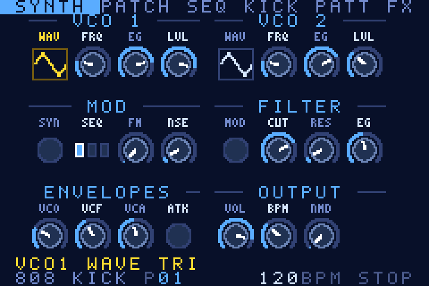<br><sub>Oscillators</sub></td>
<td align="center">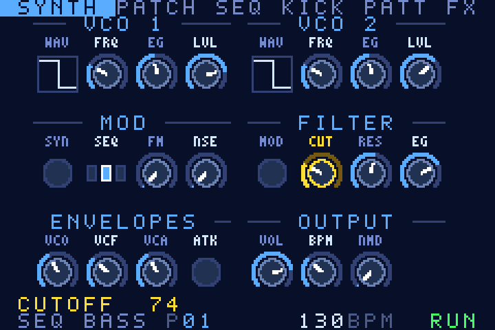<br><sub>Filter</sub></td>
<td align="center">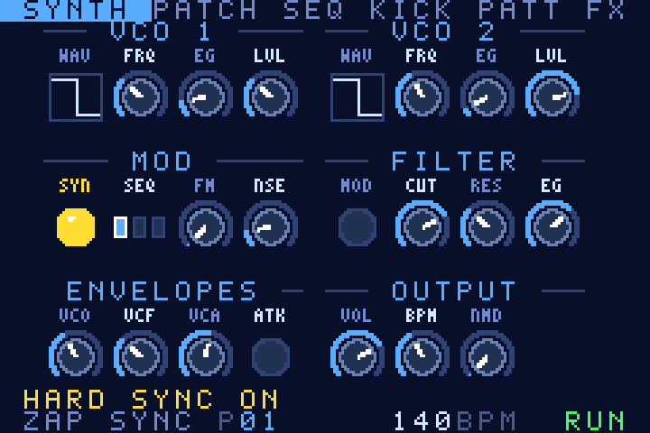<br><sub>Hard sync</sub></td>
</tr>
</table>

### PATCH

The patch bay: pick a source for each of the 8 inputs, then set the amount of the cable.

<table>
<tr>
<td align="center">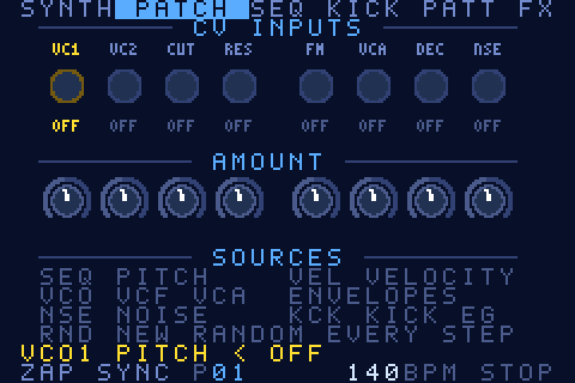<br><sub>Empty patch bay</sub></td>
<td align="center">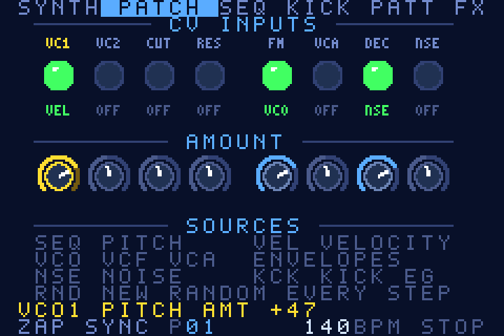<br><sub>Cables plugged</sub></td>
</tr>
</table>

### SEQ

The synth's 8 steps: a pitch row and a velocity row (0 = rest), and a conditional trig for every step.

<table>
<tr>
<td align="center">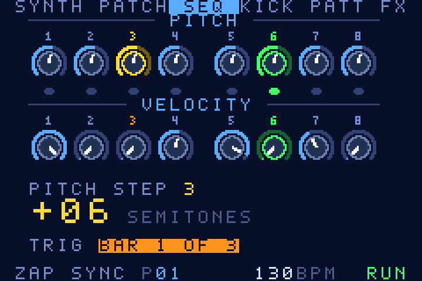<br><sub>Step with a condition</sub></td>
<td align="center">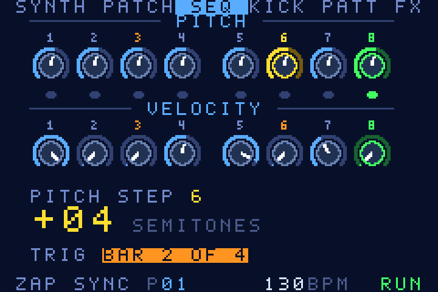<br><sub>Another step, running</sub></td>
</tr>
</table>

### KICK

16 pads (off / trig / accent), the 8 kick-sound knobs, and STEP EDIT for the parameter locks.

<table>
<tr>
<td align="center">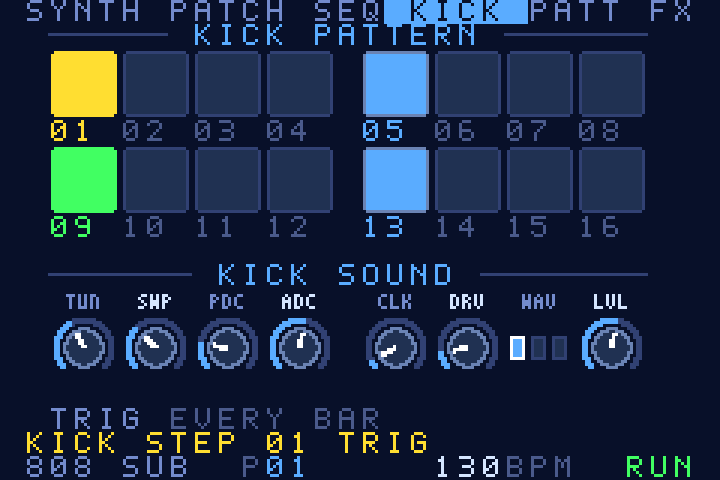<br><sub>Pads</sub></td>
<td align="center">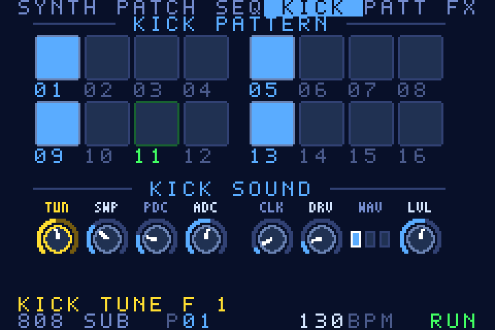<br><sub>Kick sound</sub></td>
</tr>
<tr>
<td align="center">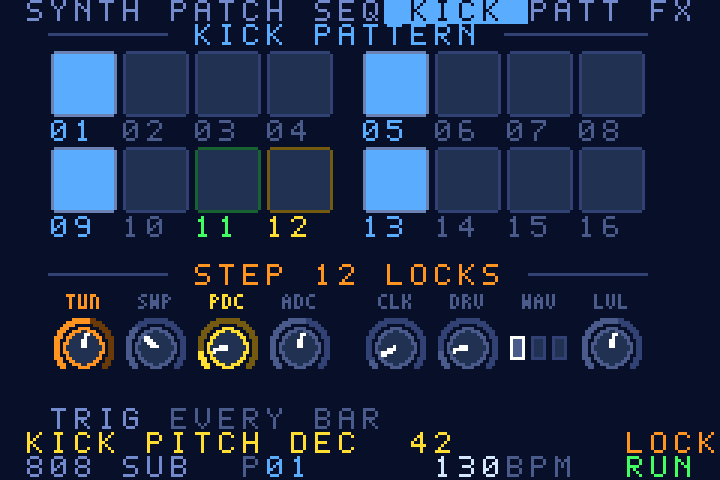<br><sub>STEP EDIT: a locked knob</sub></td>
<td align="center">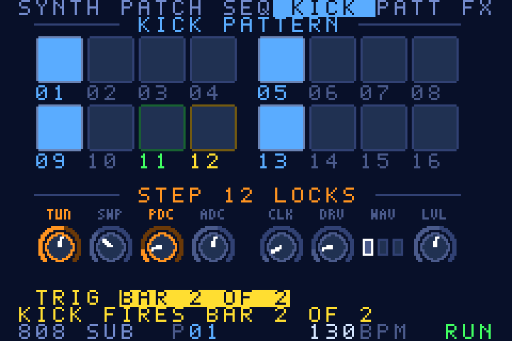<br><sub>STEP EDIT: a condition</sub></td>
</tr>
</table>

### PATT

32 patterns and a 32-slot song. Green is the pattern that plays, orange the one queued next.

<table>
<tr>
<td align="center">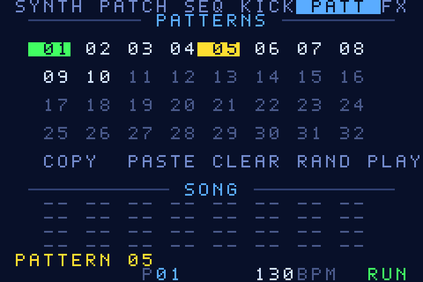<br><sub>Patterns</sub></td>
<td align="center">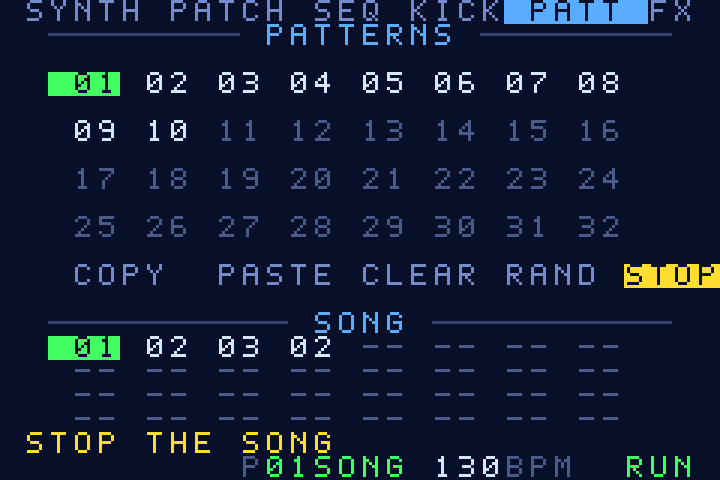<br><sub>Song playing</sub></td>
</tr>
</table>

### FX

Compressor, stutter, delay, reverb and the limiter, in that order, with its threshold.

<table>
<tr>
<td align="center">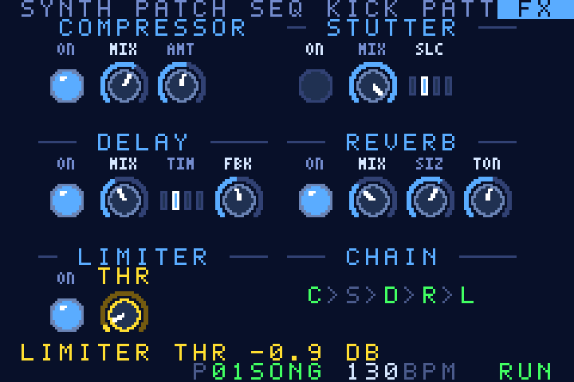<br><sub>Effects chain</sub></td>
</tr>
</table>

### Options, BPM and help

`SELECT` (tap) opens OPTIONS. `SELECT + B` is the BPM edit mode. The help has 10 pages ([all of them](docs/screens/)).

<table>
<tr>
<td align="center">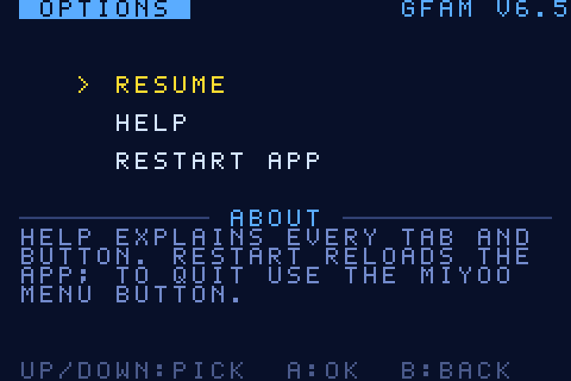<br><sub>OPTIONS</sub></td>
<td align="center">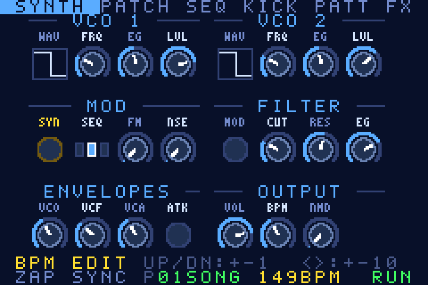<br><sub>BPM edit mode</sub></td>
<td align="center">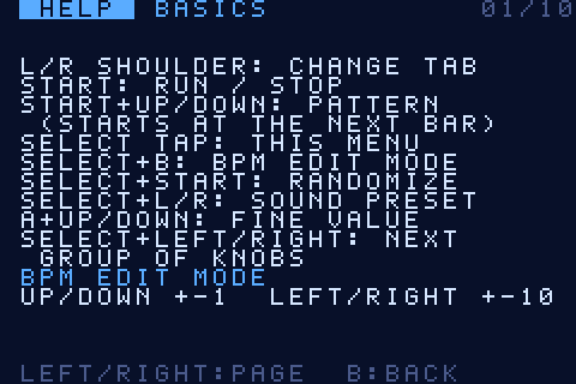<br><sub>HELP: basics</sub></td>
</tr>
</table>

## Cheat sheet

Every control on two pages. [Open the PDF](docs/GFAM-cheatsheet.pdf) (or the [HTML](docs/GFAM-cheatsheet.html) version); the same list is in [docs/CONTROLS.md](docs/CONTROLS.md).

<table>
<tr>
<td align="center"><a href="docs/GFAM-cheatsheet.pdf">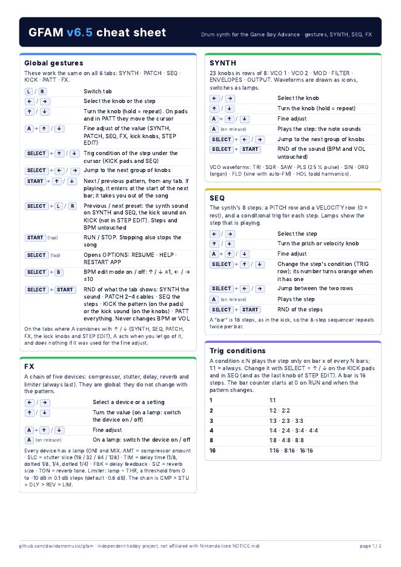</a></td>
<td align="center"><a href="docs/GFAM-cheatsheet.pdf">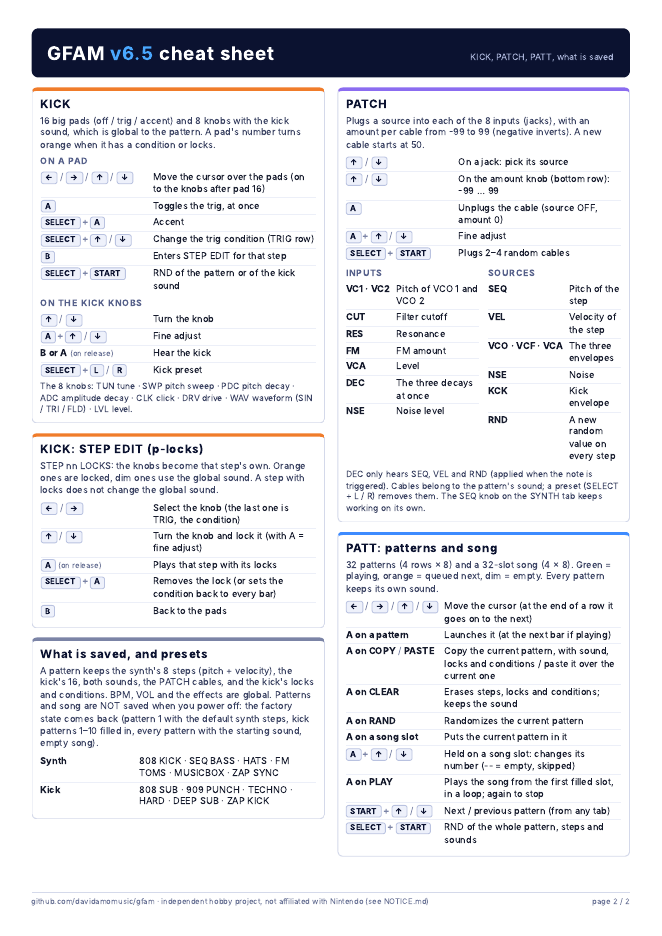</a></td>
</tr>
</table>

The gestures you need first:

| Button | Action |
| --- | --- |
| `L` / `R` | Switch tab |
| `←` `→` / `↑` `↓` | Select a knob or a step / turn it (`A` + `↑` `↓` is the fine adjust) |
| `START` (tap) | RUN / STOP |
| `START` + `↑` `↓` | Next / previous pattern, from any tab |
| `SELECT` (tap) | OPTIONS: RESUME · HELP · RESTART APP |
| `SELECT` + `B` | BPM edit mode on / off |
| `SELECT` + `START` | Randomize what the tab shows (never BPM or VOL) |
| `SELECT` + `L` / `R` | Previous / next preset |

## Run it

The ROM is in [`releases/`](releases/): `GFAM-v6.5.gba` (64 KB). Open it in a GBA emulator or load it on a handheld that runs one. GFAM was built for a Miyoo handheld (the in-app help mentions its MENU button) and its audio load was measured in mGBA. The tests in this repo do not cover a real BIOS, real hardware or flash carts.

**About the Nintendo logo.** A real GBA BIOS looks for the Nintendo logo in the header of a ROM and refuses to start it without it. To keep this repository free of Nintendo material, the ROM here has that field empty (see the [legal notice](#gfam)). So:

- An emulator that uses its own built-in BIOS (mGBA without a BIOS file, for example) runs it as it is.
- If your emulator loads a real BIOS file and plays its start-up, or you use real hardware or a flash cart, the BIOS may refuse it. For your **own device** you can build a copy whose header logo comes from a GBA ROM you already own: `make LOGO_FROM=/path/to/a-rom-you-own.gba`. Keep that copy for yourself and do not publish it.

A GBA program cannot close the emulator. `RESTART APP` (in OPTIONS) restarts the program; to quit, use the emulator's or the handheld's own menu button.

## Build it

You need `clang`, `ld.lld`, `llvm-objcopy` and `python3`.

```sh
make                 # builds build/GFAM-v<VERSION>.gba (the version is in the file VERSION)
make EXTRA=-DPROFILE # a variant that measures the render time
make LOGO_FROM=file.gba   # for your own device only: fills the header logo from a ROM you own (see "Run it")
```

The build is reproducible: the ROM in `releases/` is exactly what plain `make` produces from this source (see the SHA-256 in [releases/README.md](releases/README.md)).

## Tests and tools

```sh
sh tools/run_tests.sh              # the host tests: same DSP and UI code, compiled with gcc for the PC
python3 tools/make_screens.py      # renders docs/screens/*.png from the real UI code
python3 tools/make_cheatsheet.py   # writes the cheat sheet (HTML, PDF, PNG) and docs/CONTROLS.md
python3 tools/gen_assets.py        # regenerates src/gfx.h, src/tiles.h and src/tables.h
```

More in [docs/TECHNICAL.md](docs/TECHNICAL.md).

## Repository

| Path | What is in it |
| --- | --- |
| `src/` | The app: `synth.c` (DSP and sequencers), `fx.c` (effects), `params.c` (parameters, presets, patterns), `ui.c` (the six tabs, menu and help), `audio.c` (DMA and timers), `main.c`, `runtime.c`, `crt0.s`, `link.ld`. `gfx.h`, `tiles.h` and `tables.h` are generated and committed |
| `tools/` | `gen_assets.py` and `font.py` (tiles, palette, lookup tables), `fix_header.py` (ROM header, without the Nintendo logo), `make_screens.py`, `make_cheatsheet.py`, `run_tests.sh` |
| `test/` | Host tests and the screenshot dumper |
| `docs/` | Cheat sheet, controls, technical notes, Spanish README, screenshots |
| `releases/` | The ROM of each version, with its SHA-256 |
| `NOTICE.md` | Legal notice: trademarks, what is (and is not) in this repository, authorship, contact |
| `CREDITS.md` | Tools and ideas |
| `CHANGELOG.md` | What changed in each version |

## Licence

There is no licence file yet, so for now all rights are reserved by the author. You can read the code, build it and run the ROM for yourself; to reuse it or share it further, please ask first. A licence may be added later.
