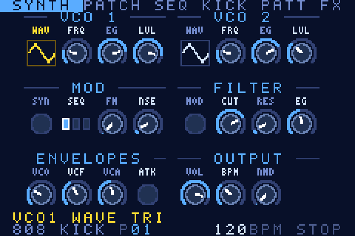
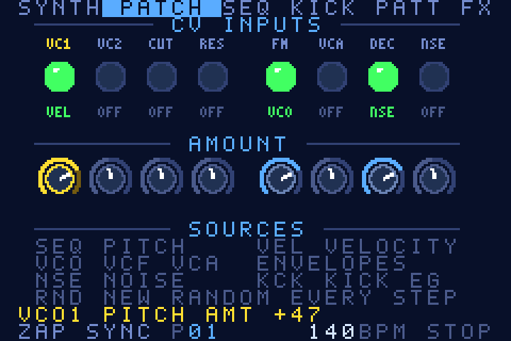
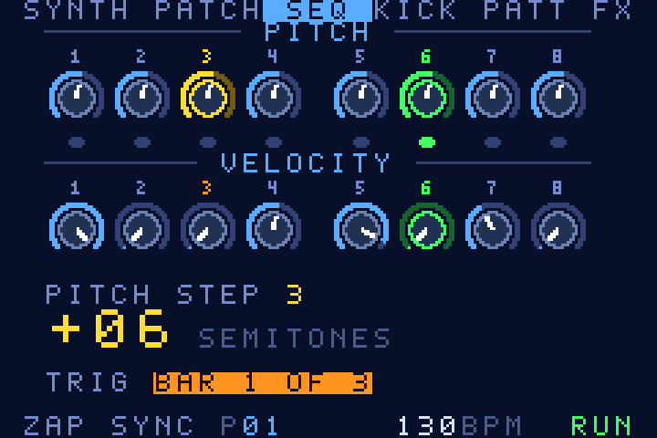
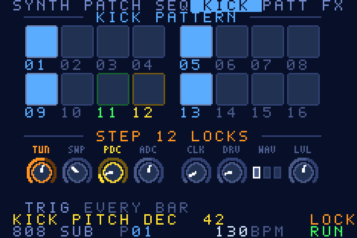
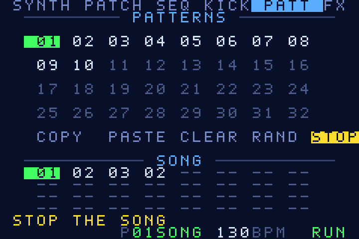
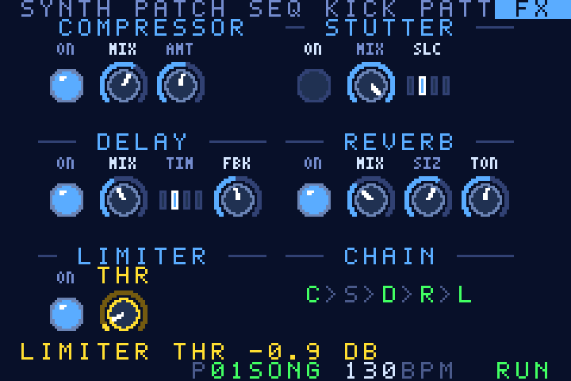

# GFAM

*Versión en español. [English README](../README.md) · [Chuleta de controles (PDF, en inglés)](GFAM-cheatsheet.pdf) · [Controles](CONTROLS.md) · [Notas técnicas](TECHNICAL.md) · [Historial](../CHANGELOG.md)*

> [!IMPORTANT]
> **Aviso legal. Léelo, por favor.**
>
> - **"GBA", "Game Boy Advance" y "Game Boy" no son mi marca.** Son marcas de Nintendo. GFAM es un proyecto de aficionado independiente, hecho para aprender y experimentar, sin fines comerciales. No está hecho, aprobado, patrocinado ni apoyado por Nintendo y no tiene ninguna relación con ellos. No sé exactamente cómo están los derechos para un programa así, así que no reclamo nada sobre esos nombres y los uso solo para decir para qué consola está escrito el programa.
> - **Este repositorio no contiene material de Nintendo**: ni BIOS, ni juegos, ni código de SDK o de librerías, y **ni siquiera el logo de Nintendo** que el hardware real de la GBA busca en la cabecera de una ROM. La ROM de [`releases/`](../releases/) está construida con ese campo vacío, y las pruebas fallan si no lo está. Todo lo demás se escribió para este proyecto.
> - Otros nombres de producto que aparecen en el repositorio son de sus dueños; ver [NOTICE.md](../NOTICE.md) (en inglés).
> - No soy abogado y esto no es asesoramiento legal: es una declaración clara de lo que contiene el proyecto y de lo que pretendo. Si eres titular de derechos y quieres que cambie o quite algo, [NOTICE.md](../NOTICE.md) dice cómo contactarme.

> [!WARNING]
> **GFAM es software beta. Úsalo bajo tu responsabilidad.** Es un proyecto de una sola persona; puede tener fallos y se ofrece "tal cual", sin garantía de ningún tipo.
> Es una ROM para un emulador o una consola portátil y no escribe nada en tu dispositivo. **Nada se guarda al apagar** (se pierden los patrones y la canción).
> Todavía no hay fichero de licencia: por ahora todos los derechos están reservados al autor; puedes leer el código, compilarlo y ejecutar la ROM para ti; para reutilizarlo o compartirlo, pregunta antes.

Sintetizador de percusión para Game Boy Advance, con patchbay virtual, secuenciador de 8 pasos, secuenciador de bombo de 16 pasos con p-locks y trigs condicionales, 32 patrones y modo canción. Proyecto de aficionado independiente y sin fines comerciales, para aprender y experimentar con síntesis de sonido en la GBA.
Interfaz en inglés. **Versión 6.5** (se muestra arriba en pantalla y en el menú; el número está en el fichero `VERSION` y en el nombre de la ROM: `GFAM-v6.5.gba`, 64 KB).

## Capturas

Las pantallas de la app tal como las dibuja el código real de la interfaz (el simulador de PC ejecuta el mismo código que la ROM; la pantalla de la GBA es de 240x160, aquí a 3x). Más en el [README en inglés](../README.md#screenshots).

<table>
<tr>
<td align="center"> SYNTH</td>
<td align="center"> PATCH</td>
<td align="center"> SEQ</td>
</tr>
<tr>
<td align="center"> KICK: STEP EDIT</td>
<td align="center"> PATT</td>
<td align="center"> FX</td>
</tr>
</table>

## Historial
- **6.5**: gestos de SELECT y B reordenados. **SELECT (toque) abre OPTIONS** (RESUME · HELP · RESTART APP; antes SELECT + B) y **SELECT + B activa/desactiva el modo BPM** (antes SELECT toque). **B ya no avanza el paso** en SYNTH ni en SEQ (en KICK, B sigue igual). La ayuda de la app está actualizada. Nuevo test `test/host_buttons.c`.
- **6.2**: en PATT el cursor ya no se para al llegar al patrón 8 (o al final de una fila): pasa a la fila siguiente mientras sigues pulsando →, y ← vuelve atrás de la misma forma. Eliminadas del código las referencias a otros equipos (nombres de ficheros de build incluidos).
- **6.1**: gestos reordenados. **A + ↑/↓ = ajuste fino** del valor (en SYNTH, PATCH, SEQ, FX y mandos del bombo; antes SELECT + ↑/↓). **SELECT + ↑/↓** pasa a ser la condición de trig en los pads de KICK y en SEQ (como en la 5.0 en el bombo). En los pads de KICK, `A` vuelve a alternar el trig al instante y `SELECT+A` es acento. En las pestañas donde A se combina con ↑/↓ (SYNTH, SEQ, PATCH, FX, mandos del bombo y STEP EDIT), A actúa **al soltarse** y no hace nada si se usó para el ajuste fino.
- **6.0**: nueva pestaña **PATCH** (patchbay de 8 entradas CV con 8 fuentes y cantidad por cable; se guarda en cada patrón); **trig condicional del sinte** por paso; condiciones ampliadas a **"compás x de N"** (1:1, 1:2 2:2, 1:3 2:3 3:3, 1:4…4:4, 1:8 4:8 8:8, 1:16 8:16 16:16); la condición se cambia con ↑/↓ del cursor (ver 6.1). ROM al límite de 64 KB.
- **5.0**: **32 patrones** y **canción de 32 posiciones** (8 columnas × 4 filas; PATT con rejilla de 8 columnas). En KICK: **p-locks** (cada paso del bombo puede tener sus propios valores de TUN, SWP, PDC, ADC, CLK, DRV, WAV y LVL) y **trig condicional** (el bombo suena el primer compás de cada 1, 2, 3, 4, 8 o 16 compases). El bombo toma sus parámetros al dispararse (antes se leían en directo). El código de control se compila con `-Os` para que la ROM siga cabiendo en 64 KB.
- **4.1**: **cada patrón guarda también el sonido** (todos los mandos del sinte y del bombo; el BPM y el VOL son globales). SELECT+START (random) ya **no cambia el BPM ni el volumen**. El limitador tiene un control **THR** (umbral de 0 a -10 dB, pasos de 0,1 dB; SELECT+↑/↓ de 1 dB) en la pestaña FX.
- **4.0**: rediseño completo de la imagen: panel con **8 mandos por fila** (8 de pitch + 8 de velocity), grupos separados con título, etiquetas pequeñas bajo cada mando, pads grandes para el bombo. Los patrones guardan los pasos del sinte y del bombo. Nueva pestaña **PATT** con 16 patrones, COPY / PASTE / CLEAR / RAND y **canción de 18 posiciones** con PLAY/STOP. START+↑/↓ cambia de patrón desde cualquier pestaña (empieza en el siguiente compás). Los presets (SELECT+L/R) cargan solo el sonido.
- **3.0**: 5 pestañas (antes 12 páginas), perillas gráficas, iconos de onda, ayuda en ventana (SELECT+B → HELP).
- **2.0**: número de versión; KICK SEQ con cursores libres; 16 patrones de bombo; SONG MODE.
- 1.x: motor de audio, kick sequencer, efectos, menú, modo BPM.

## Qué incluye
- 2 VCO con **8 formas de onda**: TRI, SQR, SAW, PLS (pulso 25 %), SIN, ORG (órgano), FLD (seno autoFM) y HOL (armónicos impares); hard sync, FM 1>2, ruido blanco, mezclador de 3 canales
- Filtro de 4 polos LP / HP con resonancia, modulación por envolvente y por ruido
- 3 envolventes de decay (VCO, VCF, VCA) con velocity por paso y ataque VCA rápido/lento
- Secuenciador principal de 8 pasos (pitch + velocity por paso, velocity 0 = silencio)
- Secuenciador de bombo de 16 pasos (trig / acento) con voz de bombo propia: tune, sweep de pitch, decay de pitch y de amplitud, click, drive, forma de onda (SIN/TRI/FLD) y nivel
- **32 patrones** (cada uno = 8 pasos de sinte + 16 de bombo + sonido de sinte + sonido de bombo + p-locks y condiciones del bombo) y **canción de 32 posiciones**
- 6 presets de bombo (808 SUB, 909 PUNCH, TECHNO, HARD, DEEP SUB, ZAP KICK) + generadores aleatorios
- **Cadena de efectos** (pestaña FX): compresor, stutter, delay, reverb y limitador (siempre el último), con ON/OFF, MIX y ajustes de cantidad / corte (slice) / tiempo / feedback / tamaño / tono

## Controles (v6.5)
**6 pestañas** (L / R las cambian): **SYNTH · PATCH · SEQ · KICK · PATT · FX**. La ayuda está dentro de la app: `SELECT` (toque) abre OPTIONS (RESUME · HELP · RESTART APP).

| Botón | Acción |
|---|---|
| L / R | Cambiar de pestaña |
| ← / → | Elegir el mando / paso |
| ↑ / ↓ | Girar el mando (mantener = repetición). En pads y PATT mueven el cursor |
| **A + ↑/↓** | **Ajuste fino** del valor (SYNTH, PATCH, SEQ, FX, mandos del bombo y STEP EDIT) |
| **SELECT + ↑/↓** | **Condición de trig** del paso bajo el cursor (pads de KICK y SEQ) |
| SELECT + ←/→ | Saltar al siguiente grupo de mandos |
| **START + ↑/↓** | **Patrón siguiente / anterior (desde cualquier pestaña; si suena, entra al inicio del siguiente compás; saca de la canción)** |
| SELECT + L/R | Preset anterior / siguiente: el sonido del sinte en SYNTH y SEQ, el del bombo en KICK (no dentro de STEP EDIT). No toca los pasos ni el BPM |
| START (toque) | RUN / STOP (parando también se detiene la canción) |
| SELECT (toque) | Abre **OPTIONS**: RESUME · HELP · RESTART APP |
| SELECT + B | Modo **BPM** (act./desact.): ↑/↓ ±1, ←/→ ±10 |
| SELECT + START | RND según pestaña: sonido (SYNTH), pasos (SEQ), patrón o sonido de bombo (KICK), patrón completo con pasos y sonidos (PATT). **Nunca cambia el BPM ni el VOL** |
| A | SYNTH/SEQ: toca el paso (al soltar). KICK pads: trig on/off al instante (SELECT+A: acento). PATCH: desenchufa. PATT: ver abajo. FX: conmuta la lámpara (al soltar) |
| B | SYNTH/SEQ: nada. KICK: sobre un pad entra en **STEP EDIT**; sobre los mandos oye el bombo |

### Pestañas
- **SYNTH**: 23 mandos en tres filas de 8: VCO 1 · VCO 2 · MOD · FILTER · ENVELOPES · OUTPUT. Ondas como dibujo, interruptores como lámparas.
- **PATCH**: patchbay virtual. Arriba, 8 **entradas** (jacks): `VC1` `VC2` (pitch de los VCO), `CUT` (cutoff), `RES` (resonancia), `FM` (cantidad de FM 1>2), `VCA` (nivel), `DEC` (los tres decays a la vez) y `NSE` (nivel de ruido). Cada jack elige una **fuente** con ↑/↓: `SEQ` (pitch del paso), `VEL` (velocity del paso), `VCO` / `VCF` / `VCA` (las tres envolventes), `NSE` (ruido), `KCK` (envolvente del bombo) o `RND` (valor aleatorio nuevo en cada paso). Abajo, el mando de **cantidad** (-99…99; negativo invierte). Un cable nuevo empieza con cantidad 50; `A` desenchufa el cable (fuente OFF y cantidad 0); `SELECT+START` enchufa 2–4 cables al azar. `DEC` solo oye SEQ, VEL y RND (se aplican al disparar la nota). Los cables forman parte del sonido del patrón y un preset (`SELECT+L/R`) los quita. La conexión SEQ→VCO original (mando SEQ de la pestaña SYNTH) sigue funcionando aparte.
- **SEQ**: fila de 8 mandos de PITCH y fila de 8 de VELOCITY (0 = silencio), lámparas del paso que suena y lectura grande del valor. **Trig condicional por paso**: `SELECT + ↑/↓` sobre un mando cambia la condición de ese paso (fila `TRIG`; el número del paso sale en naranja si tiene una). Un "compás" son 16 pasos, igual que en el bombo, así que el secuenciador de 8 pasos se repite dos veces por compás. Con `A` se toca el paso al **soltar**.
- **KICK**: 16 pads grandes (apagado / trig / acento) y los 8 mandos del sonido de bombo (global del patrón). Edita el patrón que suena. El número de un pad sale en naranja si tiene condición o p-locks.
  - **Trig condicional**: con el cursor en un pad, `SELECT + ↑/↓` cambia la condición (fila `TRIG`): "compás x de N", p. ej. `2:4` = solo el 2.º compás de cada 4; `1:1` = siempre. Opciones: 1:1, 1:2, 2:2, 1:3, 2:3, 3:3, 1:4, 2:4, 3:4, 4:4, 1:8, 4:8, 8:8, 1:16, 8:16, 16:16. El contador empieza en 0 al dar RUN y al cambiar de patrón. El trig se alterna con `A` al instante.
  - **P-locks / STEP EDIT**: `B` sobre un pad abre el editor de ese paso (título naranja `STEP nn LOCKS`). Los mandos pasan a ser los de ese paso: los que están en naranja están bloqueados; los apagados usan el sonido global. `←/→` elige mando (el último es `TRIG`, la condición), `↑/↓` gira el mando y lo bloquea (con A = ajuste fino), `A` (al soltar) suena ese paso con sus locks, `SELECT+A` quita el lock (o devuelve la condición a cada compás) y `B` vuelve a los pads. Los pasos con locks no cambian el sonido global.
- **PATT**: rejilla de 32 patrones (4 filas × 8 columnas; verde = suena, naranja = en cola, tenue = vacío). Debajo, una fila con **COPY · PASTE · CLEAR · RAND** (sobre el patrón actual) y **PLAY/STOP** de la canción. Abajo, la **canción de 32 posiciones** (4 filas × 8 columnas). Cada patrón suena con su propio sonido; COPY/PASTE copian también sonido, p-locks y condiciones, y CLEAR borra pasos, locks y condiciones pero deja el sonido. A sobre un patrón lo lanza (en el siguiente compás si suena). A sobre una posición de la canción le pone el patrón actual; con A mantenido, ↑/↓ cambia su número (`--` = vacía, se salta). A sobre PLAY reproduce la canción desde la primera posición ocupada y repite en bucle.
- **FX**: fila de dispositivos (lámpara + MIX; el limitador: lámpara + **THR**, umbral 0 … -10 dB, por defecto -0,6 dB) y fila de ajustes: AMT (cantidad del compresor), SLC (slice del stutter: 16 / 32 / 64 / 128), TIM (tiempo del delay: 1/8, 1/8 con puntillo, 1/4, 1/4 con puntillo), FBK (feedback del delay), SIZ (tamaño de la reverb) y TON (tono de la reverb). En una lámpara (ON), `A` (al soltar) o ↑/↓ enciende y apaga el dispositivo.

Salir: un programa de GBA no puede cerrar el emulador. `RESTART APP` hace un soft reset; para volver al launcher usa el botón MENU de la Miyoo.

**Qué guarda un patrón**: los 8 pasos del sinte (pitch + velocity), los 16 del bombo y el **sonido** del sinte y del bombo. Son globales (no cambian con el patrón): BPM, VOL y los efectos. Al arrancar, todos los patrones empiezan con el sonido del preset 1; el sonido se cambia al entrar el patrón (al inicio del compás si suena).
**Nada se guarda al apagar** (la ROM no usa memoria de guardado): al arrancar vuelven los patrones de fábrica (patrón 1 con los pasos del sinte por defecto, patrones de bombo 1–10 rellenos, todos los patrones con el sonido inicial) y la canción vacía.

## Presets del sintetizador
808 KICK · SEQ BASS · HATS · FM TOMS · MUSICBOX · ZAP SYNC

## Ejecutar y el logo de Nintendo
La ROM está en [`releases/`](../releases/). **No lleva el logo de Nintendo** en la cabecera (ver el aviso legal): un emulador que use su BIOS integrado (mGBA sin fichero de BIOS, por ejemplo) la ejecuta tal cual. Si tu emulador carga un BIOS real y reproduce su arranque, o usas hardware real o un flashcart, el BIOS puede rechazarla. Para tu **propio dispositivo** puedes generar una copia cuyo logo venga de una ROM de GBA que ya tengas: `make LOGO_FROM=/ruta/a/una-rom-tuya.gba`. Esa copia es para ti: no la publiques.

## Compilar
Requiere `clang`, `ld.lld`, `llvm-objcopy` y `python3`:

    make                   # genera build/GFAM-v<VERSION>.gba (versión en el fichero VERSION)
    make EXTRA=-DPROFILE   # variante que mide el tiempo de render (variables prof_max / prof_render)
    make LOGO_FROM=x.gba   # solo para tu dispositivo: rellena el logo de la cabecera desde una ROM que ya tengas (no la publiques)

La ROM de [`releases/`](../releases/) es exactamente lo que genera `make` (sin `LOGO_FROM`) con este código (SHA-256 en [releases/README.md](../releases/README.md)).

Pruebas en PC (usan el mismo código DSP y de interfaz, compilado con `gcc -DHOST`):

    sh tools/run_tests.sh              # todas las pruebas
    python3 tools/make_screens.py      # regenera docs/screens/*.png desde el código real de la interfaz
    python3 tools/make_cheatsheet.py   # regenera la chuleta (HTML, PDF, PNG) y docs/CONTROLS.md

## Notas técnicas
- **Audio** (`src/audio.c`, mismo esquema que la ROM de referencia que funciona en la Miyoo): Direct Sound A por DMA1. El Timer 0 corre libre a 18 157 Hz y **nunca se reinicia**; el Timer 1 en cascada desborda una vez por buffer (160 muestras) y su interrupción re-arma el DMA con el siguiente buffer de una cola de 4. El programa principal mantiene la cola llena (prioridad máxima) y solo después atiende botones y pantalla (sincronizado con la IRQ de VBlank), así un redibujado lento no corta el sonido. Los buffers son múltiplo de 16 bytes (el DMA de sonido mueve ráfagas de 16 bytes).
- **DSP** (`src/synth.c`): envolventes, pitch y cutoff se actualizan una vez por cada 4 muestras (con rampas lineales en los VCA); solo osciladores, filtro y amplificadores van por muestra. Corre desde IWRAM en modo ARM (aritmética entera de punto fijo, sin división).
- **Efectos** (`src/fx.c`): delay y stutter en EWRAM (64 KB / 16 KB); reverb tipo Freeverb pequeña (4 combs + 2 all-pass) a media frecuencia en IWRAM. El delay nunca reproduce contenido antiguo del buffer al reactivarse.
- Coste medido en mGBA (buffer de 160 muestras = 147 840 ciclos): ~55 % sin efectos, ~84 % con los cuatro efectos activos y bombo sonando; el redibujado de pantalla (~50 000 ciclos) lo absorbe la cola.
- `make EXTRA=-DPROFILE` genera una variante que mide el tiempo (variables `prof_render`, `prof_ui`); `-DFX_MASK=n` activa efectos por defecto para medir.
- Osciladores sin antialiasing: algo de "suciedad" digital es normal.
- **Código de juego `ZGFM`**: gpSP (y mGBA) aplican ajustes especiales según el código de la cabecera; el anterior `AGFE` es el de *Golden Sun: The Lost Age* y activaba una "puerta de traducción" del dynarec en la dirección IWRAM 0x030009AC, que ahora cae dentro del bucle de audio. No cambiar el código a uno que esté en `gba_over.h` de gpSP.
- Cabecera con checksum correcto, **sin logo de Nintendo** a propósito: un BIOS real lo necesita, un emulador con su BIOS integrado no. Para tu propio dispositivo: `make LOGO_FROM=fichero.gba` (ver más abajo).

Lista completa de pruebas y más detalle: [TECHNICAL.md](TECHNICAL.md) (en inglés).
